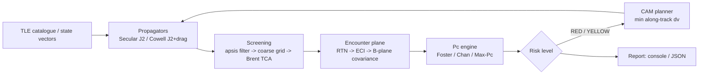

# OrbitGuard

**Space debris conjunction assessment and collision-avoidance planning for satellite operators.**

[](../../actions/workflows/ci.yml)


OrbitGuard answers the three questions every satellite operator faces when a
close approach is announced:

1. **Will something come close?** Screens a satellite against a catalogue and finds every
   time of closest approach (TCA) with sub-millisecond, sub-millimetre precision.
2. **How dangerous is it?** Computes the probability of collision (Pc) using
   three independent methods and classifies the risk.
3. **What should we do?** Designs the minimum delta-v collision-avoidance
   manoeuvre (CAM) that brings Pc below the operator's target threshold.

```text
$ orbitguard demo
OrbitGuard - Conjunction Assessment & Collision Avoidance
================================================================
Primary    : ORBITGUARD-DEMO-SAT (550 km SSO)  [Cowell: 2-body + J2 + drag]
Secondary  : DEBRIS FRAGMENT 99731
Window     : 2026-12-01T00:00:00.000Z -> 2026-12-03T00:00:00.000Z
Close approaches below 5 km: 1
----------------------------------------------------------------
CONJUNCTION
  TCA (UTC)             : 2026-12-02T08:24:00.000Z
  Miss distance         : 134.2 m
  Miss R / T / N        : +120.0 / +30.0 / +52.0 m
  Relative speed        : 13.12 km/s
  Hard-body radius      : 15.0 m
  Pc (Foster 2-D)       : 1.635e-03
  Pc (Chan series)      : 1.634e-03
  Max Pc (cov. scaling) : 1.792e-03  at k = 0.79
  Risk level            : RED
----------------------------------------------------------------
COLLISION-AVOIDANCE MANOEUVRE
  Burn epoch (UTC)      : 2026-12-02T07:35:58.873Z  (0.5 orbits before TCA)
  Delta-v R / T / N     : +0.00 / -8.33 / +0.00 cm/s
  |Delta-v|             : 8.33 cm/s
  Post-burn miss        : 518.7 m
  Post-burn Pc          : 9.933e-07  (target 1e-06)
  Candidates evaluated  : 85
----------------------------------------------------------------
Completed in 2.0 s
```

A Pc of 1.6e-3 (16x above the common 1e-4 manoeuvre threshold) is reduced to
below 1e-6 with an **8.3 cm/s** retrograde burn half an orbit before TCA.

---

## Why this matters

Low Earth orbit now holds tens of thousands of tracked objects and a far larger
population of untracked fragments. Mega-constellations, rideshare launches and
fragmentation events keep raising the rate of close approaches, and every
operator - from a university CubeSat team to a commercial constellation - needs
a defensible answer to "do we manoeuvre?" within hours of receiving a
conjunction warning. Commercial SSA services are expensive and opaque; most
small operators lack an in-house flight-dynamics capability.

OrbitGuard is an open, transparent, fully tested flight-dynamics core that a
small team can audit, run on a laptop, and extend into an operational service.

| Who | Use |
| --- | --- |
| NewSpace / CubeSat operators | Independent second opinion on conjunction warnings, manoeuvre sizing |
| Mission design teams | Collision-risk budgeting for constellation and orbit selection |
| SSA start-ups | Open core for screening, Pc and CAM services |
| Universities | Teaching astrodynamics with validated, readable code |

## Features

- **Two propagators behind one interface**
  - `SecularJ2Propagator` - analytical Kepler + J2 secular drift, fully vectorised for catalogue-wide screening.
  - `NumericalPropagator` - Cowell integration (DOP853, dense output) of two-body + J2 + atmospheric drag
    (piecewise-exponential atmosphere, co-rotating), forward and backward in time.
- **TLE ingestion** - parsing, checksum validation, 2-line / 3-line catalogues and TLE generation.
- **Conjunction screening** - perigee/apogee pre-filter, range-rate sign-change detection and Brent refinement of TCA.
- **Probability of collision**
  - Foster 2-D Pc by adaptive Gauss-Legendre x trapezoidal quadrature,
  - Chan's analytical series (via regularised incomplete gamma functions, numerically stable),
  - maximum Pc under covariance scaling (worst-case bound when covariance realism is uncertain).
- **Risk classification** - configurable RED / YELLOW / GREEN thresholds.
- **Collision-avoidance planning** - impulsive along-track burns at several lead times, geometric search plus
  bisection, each candidate verified by high-fidelity re-propagation and re-assessment.
- **CLI + JSON reports** - `orbitguard demo`, `orbitguard screen`, `orbitguard pc`.
- **35 physics-validation tests** run in CI on Python 3.10 - 3.13.

## Architecture



```
src/orbitguard/
  constants.py     WGS-84 / EGM-96 constants
  epochs.py        J2000-seconds time system
  elements.py      Kepler's equation, elements <-> state vectors
  tle.py           TLE parse / validate / generate
  atmosphere.py    exponential atmosphere (Vallado Table 8-4)
  propagation.py   secular-J2 and Cowell propagators
  frames.py        RTN and encounter-plane frames
  screening.py     conjunction screening and TCA refinement
  probability.py   Foster, Chan and max-Pc
  risk.py          covariance combination and risk classification
  maneuver.py      collision-avoidance manoeuvre planner
  scenario.py      reference encounter (demo + regression test)
  cli.py           command-line interface
```

## Quick start

```bash
git clone https://github.com/cheeranjivkumar909-blip/orbitguard.git
cd orbitguard
pip install -e ".[dev]"

orbitguard demo --json report.json          # end-to-end scenario
pytest                                      # 35 validation tests
```

### Screen a catalogue

```bash
orbitguard screen examples/synthetic_catalog.tle --primary 90001 --hours 48 --threshold-km 5
```

```text
Primary ORBITGUARD-DEMO-SAT (NORAD 90001) | window 2026-12-01T00:00:00.000Z + 48 h
Catalogue objects: 243 | after apsis filter: 42 | conjunctions < 5 km: 4 | 4.6 s
TCA (UTC)                 Secondary                    Miss [km]  Vrel [km/s]
2026-12-01T09:15:00.000Z  DEBRIS 01 (DESIGNED)             0.404        11.19
2026-12-02T16:05:59.999Z  DEBRIS 03 (DESIGNED)             0.602         7.59
2026-12-01T20:06:21.517Z  BACKGROUND OBJECT 044            1.282        15.13
2026-12-01T21:36:00.000Z  DEBRIS 02 (DESIGNED)             2.010        14.64
```

The apsis filter removes 83 % of the catalogue before any propagation. The
example catalogue is fully synthetic (`examples/build_catalog.py`) with three
objects engineered to meet the primary at known epochs (designed misses 403 m,
2012 m and 602 m) - the screener recovers all three, plus one chance encounter
from the random background population.

### Use it as a library

```python
from orbitguard import NumericalPropagator, ForceModel, find_conjunctions, assess_conjunction, plan_collision_avoidance

sat = NumericalPropagator(r0, v0, epoch_s, ForceModel(j2=True, drag=True, ballistic_coefficient=0.02))
debris = NumericalPropagator(r1, v1, epoch_s)
events = find_conjunctions(sat, debris, epoch_s, epoch_s + 2 * 86400, threshold_km=5)
risk = assess_conjunction(events[0], cov_sat_rtn, cov_debris_rtn, hard_body_radius_km=0.015)
plan = plan_collision_avoidance(sat, debris, events[0], cov_sat_rtn, cov_debris_rtn, 0.015, target_pc=1e-6)
```

### Quick Pc calculation

```bash
orbitguard pc --miss-x 0.12 --miss-y 0.05 --sigma-x 0.1 --sigma-y 0.6 --rho 0.1 --hbr 0.015
```

## Methodology

**Screening.** For two trajectories the function
`g(t) = Δr(t) · Δv(t) = ½ d|Δr|²/dt` changes sign from negative to positive at
every local minimum of range. `g` is sampled on a uniform grid and each bracket
is refined with Brent's method (`xtol = 1 µs`). At the refined TCA the relative
position is perpendicular to the relative velocity to within 1e-6 (tested).

**Encounter plane.** Each object's 3x3 RTN position covariance is rotated to
ECI and summed (objects assumed uncorrelated). The frame with `z` along the
relative velocity and `x` along the miss vector defines the encounter plane;
the 2-D miss vector `m` and covariance `C` are obtained by projection.

**Probability of collision** (short-term encounter):

```
Pc = 1 / (2π √|C|) ∬_{|x| ≤ R} exp(-½ (x - m)ᵀ C⁻¹ (x - m)) dx
```

- *Foster*: direct quadrature in polar coordinates; resolution scales with `R / σ_min`.
- *Chan*: `Pc = Σ_m Poisson(m; v/2) · P(m+1, u/2)`, `u = R²/(σx σy)`, `v = (x/σx)² + (y/σy)²`.
  Using the regularised incomplete gamma function avoids the cancellation of the textbook form.
- *Max-Pc*: `max_k Pc(m, k² C, R)` - the worst case over covariance scale.

**Manoeuvre planning.** An along-track impulse `Δv` changes the semi-major axis
by `≈ 2Δv/n`, giving a radial displacement of `≈ 4Δv/n` half an orbit later. The
planner evaluates both burn directions at 0.5, 1.0 and 1.5 orbits before TCA,
grows `Δv` geometrically until Pc drops below the target, then bisects to the
minimum. Each candidate is re-propagated with the Cowell propagator and
re-screened, so the result accounts for the actual post-burn geometry.

## Validation

| Test | Criterion |
| --- | --- |
| Kepler's equation, e ∈ [0, 0.95] | residual < 1e-12 rad |
| Elements ↔ state round-trip (200 random orbits) | position < 1 mm, velocity < 1 µm/s |
| Two-body integration, 1 day | energy and angular momentum drift < 1e-10 (relative) |
| Cowell vs analytical Kepler, -12 h … +24 h | < 1 m |
| J2 nodal regression, SSO, 15 orbits | matches theory within 3 %, ≈ +0.986 °/day |
| Drag | semi-major axis decays at 300 km |
| Foster / Chan vs closed form (isotropic, zero miss) | rel. error < 1e-6 / 1e-10 |
| Chan vs Foster (anisotropic, correlated) | < 1 % |
| Max-Pc vs analytic `R² / (e d²)` | < 1 % |
| Demo scenario | TCA within 1 ms, miss within 1 mm of design |
| Catalogue screening | all three engineered encounters recovered |

## Limitations and roadmap

OrbitGuard is a flight-dynamics core, not yet an operational service.

- TLEs are SGP4 mean elements; they are converted directly to osculating elements, which is fine for
  broad-phase screening but not for final Pc. **Next:** SGP4/SDP4 and CCSDS OMM ingestion.
- Pc assumes short-term, linear encounters. **Next:** Monte Carlo and long-term (low relative velocity) Pc.
- Covariances are user-supplied. **Next:** CCSDS Conjunction Data Message (CDM) parsing and covariance realism checks.
- Impulsive along-track burns only. **Next:** low-thrust (electric propulsion) CAM and multi-burn optimisation.
- **Next:** REST API, constellation-wide batch screening and an operator dashboard.

## References

1. J. L. Foster, H. S. Estes, *A Parametric Analysis of Orbital Debris Collision Probability and Maneuver Rate for Space Vehicles*, NASA JSC-25898, 1992.
2. F. K. Chan, *Spacecraft Collision Probability*, The Aerospace Press, 2008.
3. S. Alfano, *Relating Position Uncertainty to Maximum Conjunction Probability*, J. Astronautical Sciences, 2005.
4. D. A. Vallado, *Fundamentals of Astrodynamics and Applications*, 4th ed., Microcosm Press, 2013.
5. F. R. Hoots, L. L. Crawford, R. L. Roehrich, *An Analytic Method to Determine Future Close Approaches Between Satellites*, Celestial Mechanics, 1984.

## License

MIT - see [LICENSE](LICENSE).
